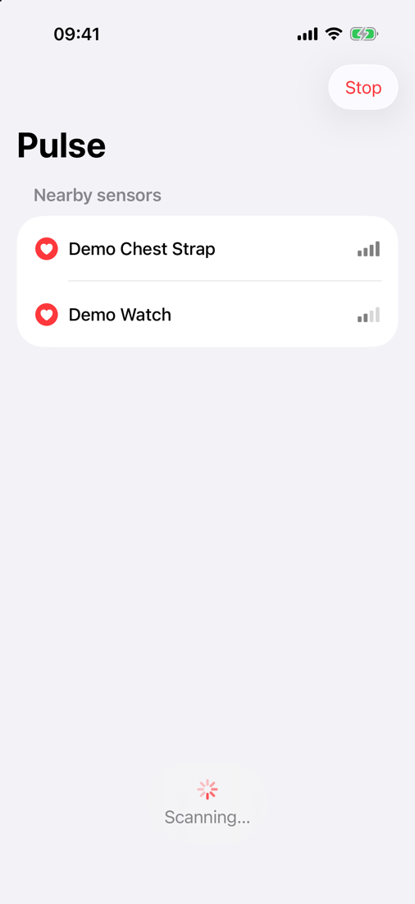
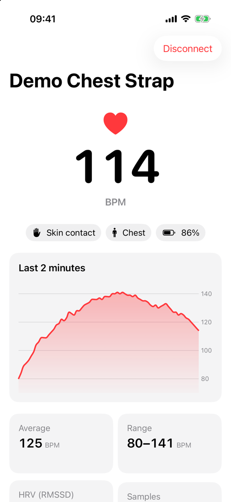
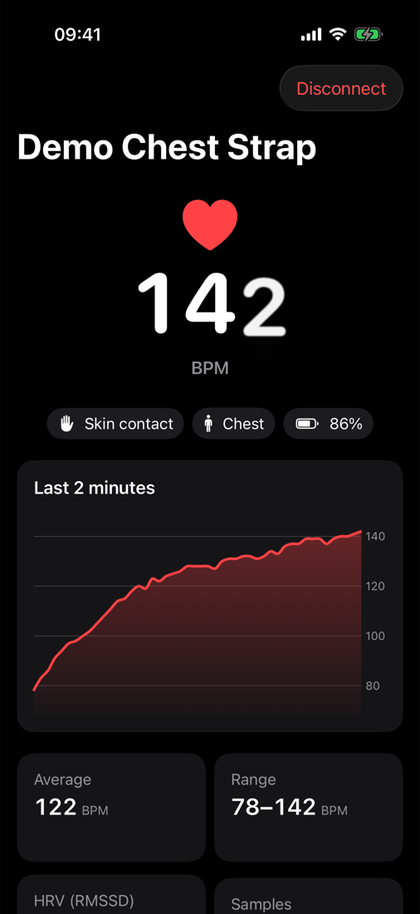

# Pulse

A SwiftUI app that reads live heart rate from Bluetooth Low Energy sensors: chest straps, armbands and watches that broadcast the standard Bluetooth **Heart Rate service**.

It shows beats per minute, a two-minute chart, sensor contact, body location, battery level and **heart rate variability (RMSSD)** computed from RR intervals.

[](https://github.com/parstuncel/pulse-ble/actions/workflows/ci.yml)


| Scan | Live | Dark mode |
|---|---|---|
|  |  |  |

## What it demonstrates

- **CoreBluetooth wrapped in Swift Concurrency.** CoreBluetooth is delegate-based. `CoreBluetoothHeartRateClient` turns it into three async streams: availability, scan and connection. Cancelling the task that consumes a stream stops the scan or disconnects, so the screen never has to keep a separate "stop" call in sync.
- **Thread safety you can reason about.** Every delegate callback arrives on one private serial queue, and all mutable state is touched only there. That is what makes the type's `@unchecked Sendable` conformance sound, and the reason is written next to it in the code.
- **A GATT decoder tested against the spec.** `HeartRateMeasurement` decodes the 0x2A37 characteristic: 8- or 16-bit heart rate, sensor contact bits, energy expended and RR intervals in 1/1024 s units. It uses typed throws and never traps on a short or malformed packet. One bad packet is logged and dropped; it does not end the session.
- **Testable by design.** The UI depends on the `HeartRateSensorClient` protocol, not on CoreBluetooth. Tests drive a mock client by hand, and a `SimulatedHeartRateClient` powers the iOS Simulator (which has no Bluetooth radio) and SwiftUI previews.
- **Modern SwiftUI.** `@Observable` view model, Swift Charts, `ContentUnavailableView`, SF Symbol effects, numeric content transitions, Dynamic Type and VoiceOver labels.
- **Swift 6 language mode** with strict concurrency checking. The package builds with zero warnings.

## Architecture

```
Pulse (app target)              thin: picks a client, shows MonitorView
└── Packages/HeartRateKit (local Swift package)
    ├── HeartRateFeature        MonitorViewModel (@MainActor, @Observable), SwiftUI screens
    └── HeartRateKit            GATT decoding, HRV, HeartRateSensorClient protocol
                                ├── CoreBluetoothHeartRateClient   real sensors
                                └── SimulatedHeartRateClient       Simulator, previews, demos
```

The app target holds only the entry point. Everything else lives in a local Swift package, so the logic and the screens build and test on their own with `swift test`, without the app.

Connection flow:

1. `scan()` scans for peripherals advertising service `0x180D`. It also lists sensors already connected to the phone, because those stop advertising.
2. `connect(to:)` discovers the Heart Rate and Battery services. It then subscribes to Heart Rate Measurement notifications and reads Body Sensor Location and Battery Level.
3. Each notification is decoded into a `SensorUpdate` and yielded to the stream. A dropped connection finishes the stream with a `SensorError`, which the view model turns into a readable message.

## Running it

Requirements: Xcode 16 or later, iOS 17 or later.

```bash
git clone https://github.com/parstuncel/pulse-ble.git
open pulse-ble/Pulse.xcodeproj
```

- **On the Simulator** the app uses the simulated sensor automatically. Tap **Scan**, then pick "Demo Chest Strap".
- **On an iPhone** it uses real Bluetooth. Most chest straps (Polar, Garmin, Wahoo and others) broadcast the standard Heart Rate service. Many watches can do the same when heart rate broadcasting is turned on. Launch with the `-demo` argument to use the simulated sensor on a device.

Run the tests:

```bash
cd Packages/HeartRateKit
swift test
```

## Tests

There are 25 tests, written with Swift Testing:

- **Decoding:** every flag combination of the Heart Rate Measurement characteristic, plus empty, truncated and half-RR-interval packets.
- **HRV:** RMSSD against hand-computed values.
- **Simulated client:** scan results, connection updates, unknown sensor IDs.
- **View model:** availability, de-duplicated scan results, the connecting → connected transition, sample trimming, statistics, and failure versus user-initiated disconnect.

## Limitations

- The app is built for foreground use. It does not use background Bluetooth modes or state restoration.
- It connects to one sensor at a time.
- The CoreBluetooth client is not unit tested, because CoreBluetooth cannot be faked without a wrapper layer. It is kept thin so that the decoding and state logic, which is tested, holds the interesting parts.

## About

I'm Pars Tuncel, a senior iOS engineer based in Munich. I built Pulse to work through CoreBluetooth and the Heart Rate profile end to end. I used [Claude Code](https://claude.com/claude-code) as a pair programmer while building it.

[parstuncel.de](https://parstuncel.de) · [LinkedIn](https://www.linkedin.com/in/pars-tuncel)

MIT License
